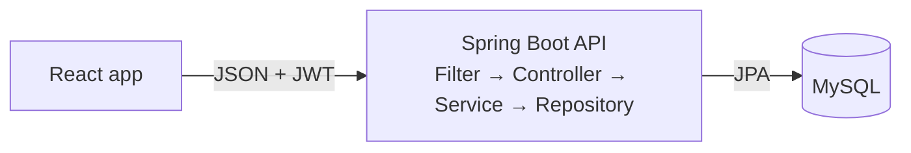

# Job Application Tracker

A full-stack web application that helps job seekers manage their whole job search in one place: applications, interview schedules, notes and statistics, with strict separation between users.

**Stack:** React 18 · Spring Boot 3.5 (Java 21) · MySQL 8 · JWT · Docker

## Problem statement

Job searches quickly spread across spreadsheets, bookmarks and email threads. It becomes hard to remember where you applied, what stage each application is in, and when the next interview is. This project gives each user one private workspace to track all of it.

## Features

- Registration, login and logout with BCrypt-hashed passwords and JWT authentication
- Profile management (name, email, password change)
- Application CRUD with company, title, description, location, job type, date, status, posting URL, salary range, recruiter name and email, and notes
- Search by company or title; filter by status, job type and date range; newest/oldest sorting; server-side pagination with configurable page size
- Interview scheduling with round, type (online, phone, in person), date and time, location or link, and notes; upcoming interview list
- Per-application notes by category (recruiter conversation, interview feedback, follow-up, preparation, general)
- Dashboard: totals per status, success rate, status distribution chart, monthly trend chart, recent applications, upcoming interviews
- CSV export of your own applications
- Responsive SaaS-style UI with loading states, empty states, toasts and confirmation dialogs
- OpenAPI / Swagger UI documentation

## Technology stack

| Area | Technology |
|---|---|
| Frontend | React 18, Vite, React Router 6, Axios, Recharts, plain CSS |
| Backend | Java 21, Spring Boot 3.5.13, Spring Web, Spring Data JPA, Spring Security, Bean Validation, jjwt 0.12.6, springdoc-openapi 2.8.9, Maven |
| Database | MySQL 8 |
| Testing | JUnit 5, Mockito, Spring Boot Test, MockMvc, H2 (tests only), Vitest, React Testing Library |
| Tooling | Docker, Docker Compose, nginx, Git |

## Architecture



Details, package responsibilities and design decisions are in [docs/ARCHITECTURE.md](docs/ARCHITECTURE.md).

**Security highlights**

- Passwords are stored only as BCrypt hashes and never returned by the API.
- The user is always derived from the validated JWT; ids supplied by the client are never trusted for ownership.
- Another user's records return `404`, so their existence is not revealed (IDOR protection).
- Secrets come from environment variables. The backend refuses to start with a missing, short or placeholder `JWT_SECRET`.
- Stateless sessions, explicit CORS allow-list, generic error messages without stack traces.

## Database design

Four tables: `users` → `job_applications` → `interviews` and `application_notes` (all one-to-many, cascading deletes). Full DDL with constraints and indexes: [database/schema.sql](database/schema.sql). ER diagram: [docs/ARCHITECTURE.md](docs/ARCHITECTURE.md#database).

## API documentation

- Endpoint reference with examples: [docs/API.md](docs/API.md)
- Postman walkthrough: [docs/POSTMAN_GUIDE.md](docs/POSTMAN_GUIDE.md)
- Interactive Swagger UI (backend running): `http://localhost:8080/swagger-ui.html`

## Project structure

```
job-application-tracker/
├── backend/            Spring Boot API (pom.xml, Dockerfile, src/main, src/test)
├── frontend/           React app (Vite, Dockerfile, nginx.conf, src/)
├── database/           schema.sql and sample_data.sql
├── docs/               ARCHITECTURE.md, API.md, POSTMAN_GUIDE.md
├── docker-compose.yml
├── .env.example
├── .gitignore
└── README.md
```

## Installation

**Prerequisites:** JDK 21, Maven 3.9+, Node.js 20+ (22 recommended), MySQL 8 (or Docker), Git.

### Option A: Docker Compose (simplest)

```bash
cp .env.example .env          # Windows cmd: copy .env.example .env
```

Edit `.env` and replace every `CHANGE_ME` value. Generate the JWT secret with `openssl rand -base64 48` or
`node -e "console.log(require('crypto').randomBytes(48).toString('base64'))"`. Then:

```bash
docker compose up --build
```

Open `http://localhost:3000`. The API is on `http://localhost:8080`, MySQL on `127.0.0.1:3307`.
`database/schema.sql` runs automatically the first time the MySQL volume is created.
To reset the database: `docker compose down -v`.

### Option B: run each part locally

1. **Create `.env`** in the project root as above. Set `DB_USERNAME`, `DB_PASSWORD` and `JWT_SECRET`.
2. **Create the database and user** (MySQL root shell). Use the same username and password as in `.env`:

   ```sql
   SOURCE database/schema.sql;
   CREATE USER 'jobtracker_user'@'localhost' IDENTIFIED BY 'your_db_password';
   GRANT ALL PRIVILEGES ON job_tracker.* TO 'jobtracker_user'@'localhost';
   ```

   From a terminal: `mysql -u root -p < database/schema.sql`.
3. **Start the backend** (it reads `../.env` automatically when started from `backend/`):

   ```bash
   cd backend
   mvn spring-boot:run
   ```

4. **Start the frontend** in a second terminal:

   ```bash
   cd frontend
   npm install
   npm run dev
   ```

   Open `http://localhost:5173`. Vite proxies `/api` to port 8080, so no CORS setup is needed locally.

### Optional sample data

Register `demo@example.com` through the app, then load the demo records:

```bash
mysql -u root -p < database/sample_data.sql
```

Never load this file in production.

## Environment variables

See [.env.example](.env.example) for every variable with explanations. The important ones:

| Variable | Purpose |
|---|---|
| `DB_URL`, `DB_USERNAME`, `DB_PASSWORD` | Database connection |
| `JWT_SECRET` | HMAC signing key, at least 32 characters, never committed |
| `JWT_EXPIRATION_MINUTES` | Token lifetime (default 60) |
| `CORS_ALLOWED_ORIGINS` | Browser origins allowed to call the API |
| `APP_TIMEZONE` | Time zone used for "upcoming" interviews and monthly grouping |
| `SWAGGER_ENABLED` | Set `false` in production |
| `VITE_API_BASE_URL` | API base URL baked into the frontend build |

## Testing

```bash
# Backend: unit, repository and MockMvc integration tests (in-memory H2, no MySQL needed)
cd backend
mvn test

# Frontend: component, form validation and auth-flow tests
cd frontend
npm install
npm test
```

**Reading the results**

- Maven prints `Tests run: N, Failures: 0, Errors: 0` and `BUILD SUCCESS` when everything passes. Reports are in `backend/target/surefire-reports/`.
- Vitest prints each test file with a check or cross and a final `Tests N passed`. A failure shows the assertion diff and the line in the test.
- **Backend coverage:** registration, login, JWT service, application CRUD, search and filter repository queries, cross-user authorization, interviews and notes, validation, dashboard statistics, CSV export and the global exception handler.
- **Frontend coverage:** login, registration, application form validation, application list with filtering, dashboard rendering, interview form, auth flow and utility functions.

## Deployment (low-cost options)

Deploy the three parts separately and connect them with environment variables.

1. **Database:** a managed MySQL 8 instance (for example Aiven's free tier, or MySQL on Railway). Run `database/schema.sql` once. Use a dedicated least-privilege user and enable TLS if the provider offers it, adding `useSSL=true` to `DB_URL`.
2. **Backend:** any host that runs a Docker image or a Java 21 jar (Render, Railway, Fly.io). Build context is `backend/` and the container listens on port 8080. Set `DB_URL`, `DB_USERNAME`, `DB_PASSWORD`, a fresh `JWT_SECRET`, `CORS_ALLOWED_ORIGINS` (exactly your frontend origin, no trailing slash), `SWAGGER_ENABLED=false`, and `APP_TIMEZONE`. Use `/actuator/health` as the health check.
3. **Frontend:** build with `VITE_API_BASE_URL=https://your-api-host/api`, then host `frontend/dist` on a static host (Netlify, Vercel, Cloudflare Pages) with a rewrite of all paths to `/index.html` for React Router. Alternatively deploy `frontend/Dockerfile`, but note its nginx config proxies `/api` to a host named `backend`, so edit `nginx.conf` for that setup.
4. **Verify:** open the deployed site, register, add an application, reload to confirm persistence, and check the browser console for CORS errors.

Free tiers may sleep when idle, so the first request can be slow.

Production checklist: HTTPS only, unique long `JWT_SECRET`, Swagger disabled, CORS restricted to your domain, database not publicly reachable where the provider allows it, regular backups.

## Screenshots

_Screenshots have not been added yet. After running the app, capture the Dashboard, Applications, Application details and Interviews pages and place them in `docs/screenshots/`, then link them here._

## Future improvements

- Refresh tokens and server-side token revocation
- Email or push reminders for interviews and follow-ups
- Kanban board view by status
- Contact and company records, file attachments (resume, offer letter)
- Flyway migrations instead of a single schema script
- Rate limiting on authentication endpoints
- End-to-end browser tests (Playwright)
- CI pipeline (GitHub Actions) running both test suites

## GitHub setup

**Suggested repository name:** `job-application-tracker`

**Suggested commit sequence**

```
chore: initialize repository with .gitignore and project structure
feat(db): add MySQL schema and sample data
feat(backend): add entities, repositories and base configuration
feat(auth): add registration, login and JWT security
feat(applications): add application CRUD with ownership checks
feat(search): add filtering, sorting and pagination
feat(interviews): add interview and note management
feat(dashboard): add statistics endpoint and CSV export
feat(frontend): add layout, routing and authentication pages
feat(frontend): add applications, interviews and dashboard pages
test: add backend and frontend automated tests
build: add Dockerfiles and Docker Compose
docs: add README, architecture and API documentation
```

Use the imperative mood, a type prefix (`feat`, `fix`, `test`, `docs`, `build`, `chore`, `refactor`) and keep the first line under about 70 characters. Before the first push, confirm `git status` does not list `.env`.

## License

Add a license of your choice (for example MIT) before publishing.
