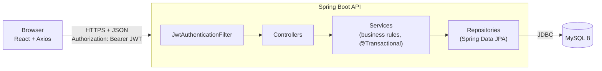
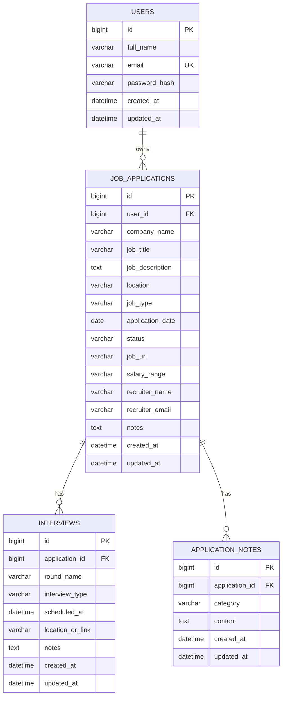

# Architecture

## System overview

In Docker Compose the browser only talks to **nginx** (port 3000). nginx serves the React build and forwards `/api/*`
to the backend container, so the browser sees a single origin and no CORS configuration is needed. When the frontend
and backend are hosted on different domains, CORS is controlled by `CORS_ALLOWED_ORIGINS`.

## Backend packages (`com.jobtracker`)

| Package | Responsibility |
|---|---|
| `controller` | HTTP in/out only: routing, `@Valid`, status codes. No business logic. |
| `service` | Business rules, ownership checks, transactions, CSV export, dashboard calculations. |
| `repository` | Spring Data JPA interfaces and `JobApplicationSpecifications` (dynamic search filters). |
| `entity` | JPA mappings: `User`, `JobApplication`, `Interview`, `ApplicationNote`, `BaseEntity` (timestamps). |
| `dto` | Request and response records. Entities are never serialised directly. |
| `mapper` | Entity to DTO conversion. |
| `security` | JWT creation and validation, request filter, `UserPrincipal`, JSON 401/403 handlers. |
| `config` | `SecurityConfig` (filter chain, CORS, BCrypt), OpenAPI, `Clock`. |
| `exception` | Domain exceptions and `GlobalExceptionHandler` producing a uniform `ErrorResponse`. |

## Authentication flow

1. `POST /api/auth/register` or `/login` verifies credentials (BCrypt) and returns a signed JWT (HS256).
2. The frontend stores the token and the Axios request interceptor adds `Authorization: Bearer <token>`.
3. `JwtAuthenticationFilter` validates signature and expiry, loads the user and puts a `UserPrincipal` in the security context.
4. Controllers receive the principal through `@AuthenticationPrincipal`. **The user id never comes from the request.**
5. An expired or invalid token yields `401`; the Axios response interceptor clears the session and redirects to login.

## Data isolation (IDOR prevention)

Every service method takes the authenticated user's id from the security context. Applications are loaded with
`findByIdAndUserId(...)`; interviews and notes are loaded through their parent application's owner. A record that
belongs to another user is reported as **404 Not Found**, so the API does not reveal that it exists. Integration tests
(`ApplicationIntegrationTest`, `InterviewAndNoteIntegrationTest`, `DashboardIntegrationTest`) cover cross-user access.

## Search, filtering and pagination

`GET /api/applications` builds a JPA `Specification` from the optional criteria (text search on company or title,
status, job type, date range). Sorting and pagination run in the database (`Pageable`), and the page size is capped at 100.
Composite indexes `(user_id, application_date)`, `(user_id, status)` and `(user_id, job_type)` back these queries.

## Database

The full DDL, with constraints and indexes, is in [`database/schema.sql`](../database/schema.sql). Foreign keys use
`ON DELETE CASCADE`, so deleting an application removes its interviews and notes, and deleting a user removes everything they own.

## Frontend structure (`frontend/src`)

| Folder | Contents |
|---|---|
| `pages` | One component per route (Login, Register, Dashboard, Applications, Add/Edit/Details, Interviews, Profile, NotFound). |
| `components` | Reusable UI: layout and sidebar, forms, table, pagination, modal, confirm dialog, empty state, spinner, badges. |
| `services` | Axios instance (token interceptor, error helpers) and one module per API area. |
| `context` | `AuthContext` (session) and `ToastContext` (notifications). |
| `hooks` | `useDebounce`, `useDocumentTitle`. |
| `utils` | Constants and enum labels, formatters, form validators. |
| `styles` | Global CSS (light theme, indigo accent, responsive layout). |

## Key design decisions

- **Stateless JWT** keeps the API horizontally scalable. The trade-off is that tokens cannot be revoked before they expire, so the expiry is short (default 60 minutes). A refresh-token flow is listed under future improvements.
- **Schema owned by SQL**, not Hibernate (`ddl-auto=none`), so production schema changes are explicit. Tests use H2 with `create-drop`.
- **Enums stored as strings** with `CHECK` constraints for readable data and safe reordering.
- **Records for DTOs** give immutability with little boilerplate.
- **Interview times are stored as local date-time** (no zone). "Upcoming" is evaluated in `APP_TIMEZONE`.
